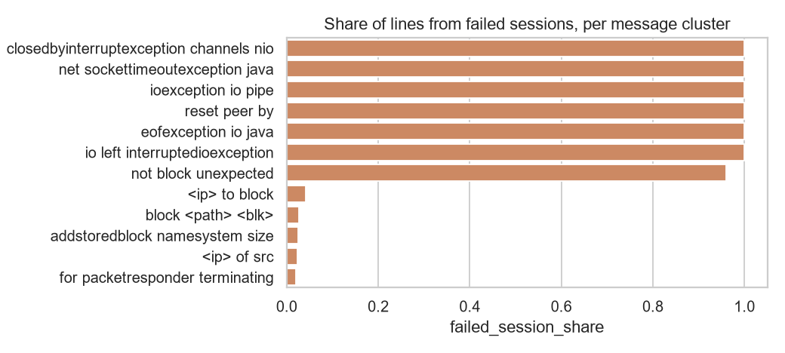
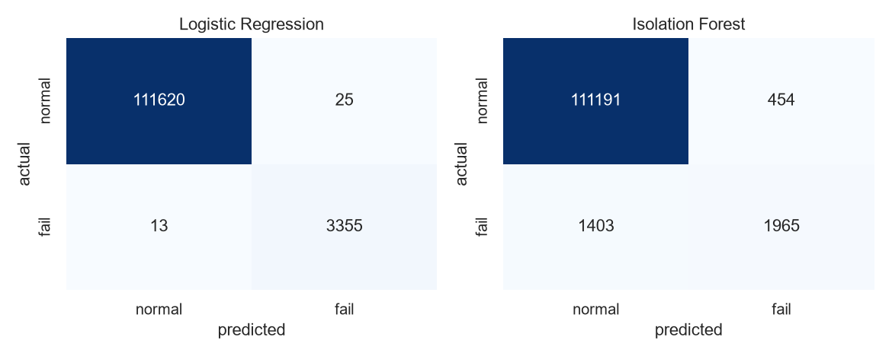
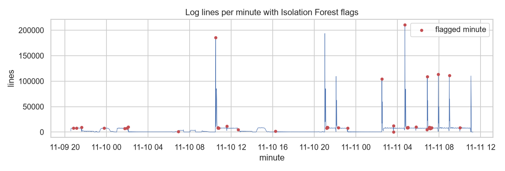

# Log Failure ML: ML-Based Failure Triage on System Logs

Machine learning on real system logs to do three things a test/validation team
does by hand: **group failure messages by type**, **predict which sessions
failed**, and **flag unusual time periods**.

Data: [Loghub HDFS_v1](https://github.com/logpai/loghub) (Zenodo
[8196385](https://zenodo.org/records/8196385)), 11,175,629 log lines from a
Hadoop cluster, 575,061 sessions (HDFS blocks), 16,838 labelled as failed (2.9%).

## Results (full dataset, seed 42)

| Step | Method | Result |
|---|---|---|
| Failure clustering (unsupervised NLP) | Mask IDs/IPs/numbers, TF-IDF, k-means (k chosen by silhouette) | 54 message types into 12 clusters; the 7 exception/error clusters are 96 to 100% failed-session lines, normal clusters 2 to 4% |
| Failure prediction (supervised) | Per-session event counts, log1p, Logistic Regression tuned with GridSearchCV (5-fold, F1) | Test precision 0.993, recall 0.996, F1 0.994, ROC-AUC 0.9996 |
| Session anomaly detection (no labels) | Isolation Forest | Test precision 0.81, recall 0.58, F1 0.68, ROC-AUC 0.956 |
| Time-series anomaly detection | Per-minute event-type counts, Isolation Forest | 47 of 2,322 minutes flagged; flagged minutes carry 3x the failed-session share (7.5% vs 2.5%); 13 of the 48 worst minutes caught |

Honest notes:
- HDFS is a well-known, fairly easy benchmark. Supervised scores near 0.99 are
  in line with published results, so the interesting part is the gap between
  supervised (labels) and unsupervised (no labels) detection.
- Isolation Forest's contamination is set to the training failure rate, which
  assumes the rough failure rate is known.
- The time-series signal is modest: it raises the failure share 3x but misses
  most of the worst minutes. Per-minute counts mix many sessions together.





## How it works

1. `src/logtools.py` parses each line (`date time pid level component: message`)
   and masks variable fields (`blk_...` to `<BLK>`, IPs to `<IP>`, paths, numbers)
   so lines describing the same event become the same text.
2. `src/pipeline.py` reads the 1.6 GB log line by line (constant memory),
   counts masked messages and per-minute activity, then runs the four steps
   above and writes `results/metrics.json` plus plots.

## Run

```bash
pip install -r requirements.txt
./run.sh            # downloads HDFS_v1 (~187 MB) once, runs tests, runs pipeline
pytest -q tests     # unit tests only
```

Full run takes about 7 minutes on a laptop. GitHub Actions runs the tests on every push.
